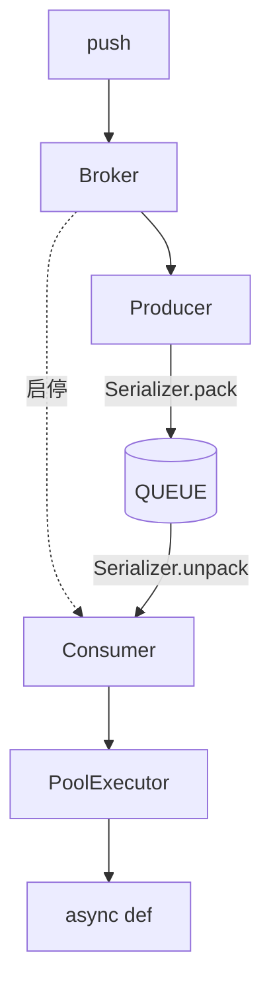

# queue-func

把 **`async def` 协程** 变成可 **`push`** 的队列任务：在 asyncio 里投递、消费，并按通道控制并发与背压。

需要 **Python 3.12+**；任务入口必须是协程，不支持普通 `def`。

仓库：[github.com/sekil9529/queue-func](https://github.com/sekil9529/queue-func)

## 特点

- **asyncio 原生**：consumer 在同一事件循环里池化 `await` 任务，与 FastAPI / Starlette 等同进程组合很自然。
- **运行时聚焦队列链路**：`pack` → 投递 → `unpack` → 执行；生命周期由 `broker` / `QueueFuncRuntime` 显式管理。
- **环节可扩展**：通过 `register_backend` 接入新队列；`Serializer.pack` / `unpack` 决定队列里的数据结构。
- **每个 `QueueFunc` 独立消费并发**：各自 `consumer_pool_maxsize`。一个进程里可用 `QueueFuncRuntime` 同时跑多段流水线（例如 count → list → detail），**各段并发互不影响**。

## 架构设计

### Func

业务协程：一个 `async def`，用 `@queue` 装饰。

### Queue

装饰之后，这个 Func 就是一条队列，`push` 投到它自己这条队列上。

### Broker

组装 Producer、Consumer 的公有对象，提供对外接口。

### Serializer

控制队列中的数据结构：`pack` 写入，`unpack` 读出后还原成 `(args, kwargs)`。

- `raw.Serializer`：队列中保持 `(args, kwargs)`。
- `orjson_ser.Serializer`：队列中是 `bytes`。

### Producer

调用 `Serializer.pack` 后把数据写入队列。

### Consumer

从队列得到数据，`Serializer.unpack` 后交给 PoolExecutor 执行。

### PoolExecutor

按并发上限执行业务协程。


### 组件关系



## 当前实现

| Backend | 说明 |
|---------|------|
| **`Backend.QUEUE`** | 进程内 `asyncio.Queue`（已可用） |
| RabbitMQ、Kafka 等 | 通过同一套 Broker / Producer / Consumer 扩展点接入（见 [Changelog.rst](Changelog.rst)） |

接入 MQ 后端后，producer / consumer 可部署在不同进程或机器；**现阶段发行版仅包含内存队列实现**。

## 快速开始

安装（开发）：

```bash
git clone https://github.com/sekil9529/queue-func.git
cd queue-func
poetry install
```

单个 `QueueFunc`：

```python
import asyncio

from queue_func.factory import Backend, queue


@queue(Backend.QUEUE, consume_timeout=0.5, maxsize=1000)
async def process_order(order_id: int):
    ...


async def main():
    await process_order.broker.start_consumer()
    await process_order.push(args=(42,))
    await process_order.broker.stop_consumer()
    await process_order.broker.join_consumer()


asyncio.run(main())
```

- `push` 等价于 `broker.publish(coro_args=..., coro_kwargs=...)`
- 仍可直接 `await process_order(1)`，不经过队列

多段流水线（各段独立队列与并发上限）：

```python
from queue_func.factory import Backend, QueueFuncRuntime, queue

# task_count 内 await task_list.push(...)，task_list 内 await task_detail.push(...)


async def main():
    runtime = QueueFuncRuntime([task_count, task_list, task_detail])
    await runtime.start()  # 按列表反序启动 consumer，下游先就绪
    await task_count.push(args=(...,))
    await runtime.stop()
```

链式示例（含日志）：

```bash
poetry run python examples/demo_queue.py
```

常用配置：`maxsize` / `publish_timeout`（队列背压与投递等待）、`consumer_pool_maxsize`（同时执行的协程数）、`serializer_cls`（队列中的数据结构）。低级组装见 `queue_func.config.queue.Config` 与 `queue_func.broker.queue.Broker`。

## 项目结构

```
queue_func/
├── broker/
├── producer/
├── consumer/
├── serializer/       # raw、orjson
├── config/
├── factory/          # @queue、QueueFunc、QueueFuncRuntime
└── pool_executor/
examples/
└── demo_queue.py
```

## 开发与测试

版本与路线图：[Changelog.rst](Changelog.rst)

```bash
pytest tests/ -q
```

## 许可证

Apache-2.0
